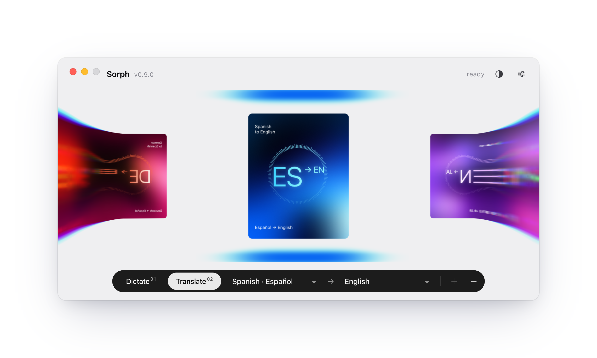

# Sorph

**Language is no longer a barrier. It's a bridge.**

Sorph is free, private dictation and translation for macOS. Hold a key,
speak, release: your words appear in the text field you were typing in,
in your language or in someone else's.

<picture>
  <source media="(prefers-color-scheme: dark)" srcset="assets/release/dashboard-dark.png">
  
</picture>

## Everyone speaks their own language. Everyone is understood.

- **Speak yours, write theirs.** Say it in Spanish and it is written in
  English; say it in English and it is written in Japanese. Any of 99
  spoken languages into any other. Your own words appear as you say
  them, and the translation takes their place when you let go.
- **Or just dictate.** In 99 languages, typed straight into the field
  you are working in, about a second and a half behind your voice.
- **Privately, on your own machine.** Everything runs on your Mac. No
  account, no API key, no credits, no cloud: nothing you say ever leaves
  it.
- **Light.** 0.8 GB to install for dictation in every language. The
  translation model (2.5 GB) is downloaded the first time you turn
  translate mode on.

```
Hold Right-Option → mic capture
    → faster-whisper (speech-to-text on your CPU, 99 languages)
    → words typed into your text field as you speak, corrected in place
    → on release: cleanup (fillers, capitalization), or the translation
      in the language you chose, written in place of your words
```

[sorph.me](https://sorph.me) · [What's new in v0.9.0](https://github.com/TrenchStrAvy/Sorph-Local-Multilingual-Transcription/releases/latest)

## Key features

- **100% offline.** Speech-to-text runs locally with
  [faster-whisper](https://github.com/SYSTRAN/faster-whisper). The optional
  cleanup pass runs on a local language model. There is no server, no
  telemetry, and nothing to pay for.
- **99 languages.** English, Deutsch, Français, Español, 日本語, العربية and
  every other language Whisper knows. One multilingual model covers them
  all, so adding a language is a menu click, not a download.
- **Translate mode.** Speak one language, get text in another: pick
  what you speak under **Language** and what should be written under
  **Translate** (French in, Arabic out; or any other pair). Translated
  on your Mac by a model Sorph installs and runs itself. See [Translate mode](#translate-mode).
- **Hands-free lock.** Tap **A** while holding Right-Option and dictation
  stays on after you let go. Speak in sentences; each one is committed on
  the pause that follows it and never touched again. Switch to another app
  and keep working: typing pauses and catches up the moment your field is
  focused again. Tap Option+A once more to finish.
- **Fast keys: switch language without stopping.** While holding
  Right-Option, tap **Q** for German, **W** for French, **E** for English
  (defaults). Assign Q, W, E, R, and T to any languages you like from the
  menu bar. The letter never reaches your document; the current sentence
  is transcribed in the new language.
- **Text lands where you started.** If you click somewhere else while
  speaking or while transcription is running, Sorph brings the
  original app and text field back into focus before pasting.
- **Words appear as you speak.** About a second and a half behind your
  voice, the recognized words are typed straight into the field you are
  dictating into. When later audio refines a word, it is corrected in
  place. `--preview card` shows them in the overlay instead; `--preview
  off` waits for release.
- **Cleanup you can watch.** On release, filler words ("um", "äh", "euh")
  vanish and capitalization and end punctuation are fixed, right in your
  text. This pass is rule-based: it never rewrites a sentence. An optional
  local LLM pass (`--cleanup`, gemma3:4b) streams its edits the same way and
  is discarded if it drops or invents content.
- **Only what you said.** Sorph learns how loud your voice is on each
  microphone and keeps quiet passages only when it is sure they are
  speech, so a TV or music in the room does not turn into sentences.
- **Your words.** Menu bar → **Dictionary** teaches Sorph a name or a
  term (`Ollama`), or a fix for one it mishears
  (`terror form = Terraform`).
- **Correct yourself out loud.** "Tuesday, actually no, Wednesday"
  becomes "Wednesday"; "scratch that" works too (English).
- **Per-app tone.** A one-line dictation gets no final period in chat
  apps, terminals and code editors; documents and mail get one.
- **Works on Intel Macs.** Uses the int8 CPU path, not Apple-Silicon-only
  frameworks. A 6-second dictation lands in about 1.3 seconds on an i9,
  or about 2.5 seconds with the cleanup pass enabled.
- **A sphere that listens.** A small ball of liquid glass with ribbons of
  light flowing inside, rendered on the GPU. It refracts what is behind
  it, and your voice bends the ribbons, stirs the glass and lights the
  rim. It adapts to how loud you speak, so a quiet voice moves it as much
  as a loud one. Put it in any screen corner from the menu bar, or drag
  it anywhere you like.
- **Native feel.** A mic icon in the menu bar, a startup splash while the
  model loads, a Sorph icon in Launchpad, and a service that starts
  at login.
- **Clipboard-safe.** Whatever you had copied is restored after the paste.

## Install

macOS 13 or later (13.3 for translate mode's Gemma), Python 3.10 or
later. One command after cloning:

```bash
git clone https://github.com/TrenchStrAvy/Sorph-Local-Multilingual-Transcription.git sorph
cd sorph
./install.sh
```

The installer creates a virtual environment, installs dependencies,
downloads the speech model, builds a named **Sorph** runtime app (so
macOS privacy settings show "Sorph" instead of "Python"), places a
**Sorph** launcher in `/Applications` and Launchpad, and installs a
login service. Re-running it is safe.

**What gets downloaded: about 0.8 GB.** That is everything dictation
needs, in all 99 languages: the speech models (0.6 GB: `small.en` and
`small` for the text, `base` for the live preview), the llama.cpp
runtime for translate mode (13 MB), and the Python packages (about
0.2 GB). Nothing more is fetched while you dictate. The speech models
are OpenAI's Whisper stored as 8-bit weights, the precision Sorph runs
them at, which halves their size (see `speech.py`).

**Translate mode adds 2.5 GB, once, the first time you turn it on**:
Gemma 3, with the progress shown in the menu bar and in Sorph's window.
Until it is there, a dictation is written as spoken. `--translate`
downloads it during the install instead, for a Mac that will be offline.

Memory: about 1 GB while dictating, about 4 GB more while translate
mode or the cleanup pass is on.

| Flag             | Effect                                                            |
|------------------|-------------------------------------------------------------------|
| `--with-cleanup` | enable the cleanup pass. It runs on Gemma 3, which is downloaded now (2.5 GB); no Ollama, no Homebrew |
| `--translate`    | download the 2.5 GB translation model now, not when translate mode is first turned on |
| `--no-translate` | never download it; translate mode then uses a smaller, rougher model. Undo with `--translate` |
| `--model NAME`   | pre-download a different Whisper model (`tiny.en`, `medium.en`)    |
| `--no-service`   | set up the environment only; run `flow.py` from a terminal yourself |

### Permissions (once)

macOS will not let any program listen for a global hotkey or paste into
other apps without these. In **System Settings → Privacy & Security**,
grant them to **Sorph**:

1. **Microphone**: macOS asks automatically on the first recording.
2. **Accessibility**: needed to paste and to re-focus the original field.
3. **Input Monitoring**: needed for the hotkey and the fast keys.

Then click **Sorph** in Launchpad (or restart the service, below).

## Use

Hold **Right-Option** while speaking and release when done. The glass
sphere appears while recording and reacts to your voice. Your words show up
in the field where your cursor was when you pressed the key, a moment
behind your voice; after release the cleanup pass tidies them and the
sphere goes away. Without a text field in focus (Finder, the Desktop),
nothing is typed: as your first words are heard a short sound plays and
the sphere goes away, and the words are left on the clipboard (or pasted
into a field you click into before the sound). Holding the key without
speaking, to switch language, stays silent.

**Sphere position.** Menu bar → **Sphere position**: bottom left (default),
bottom center, bottom right, top left, top right, or **Move freely…** to
drag it anywhere. Press **Return** or choose **Done moving** to keep the
spot. `--position top-right` works from the command line too.

**Music ducking.** When something is playing (Music, Spotify, a browser:
any app), Sorph turns the system volume down as you press the hotkey and
glides it back after you release. Menu bar → **Music ducking** has a
slider for how far down it goes, from silent to 100% of your current volume
(default 20%), and a switch to turn it off. If you change the volume
yourself mid-dictation, Sorph keeps your change.

Click the **mic icon** in the menu bar for everything else:

| Menu item             | What it does                                                    |
|-----------------------|-----------------------------------------------------------------|
| **Language ▸**        | switch between your enabled languages; each shows its fast key   |
| **Quick keys ▸**      | assign Q / W / E / R / T to any enabled language, or clear them |
| **Add language ▸**    | browse the full catalog (grouped A–Z) and add one to the menu   |
| **Remove language ▸** | take one out of the menu and off its fast key                   |
| **Music ducking ▸**   | slider: how far playing audio goes down while you dictate; off  |
| **Quit Sorph**   | stop the service until you start it again from Launchpad        |

Defaults: English, Deutsch, and Français enabled; **Q** = Deutsch,
**W** = Français, **E** = English. Choices persist in
`~/Library/Application Support/LocalFlow/settings.json`.

### Locked (hands-free) dictation

Hold **Right-Option**, tap **A**, let go. The sphere's rim turns amber, the
caption shows a 🔒, and the
menu bar status says "locked". Everything you say is typed into the field
you started in, sentence by sentence: a pause of about 0.7 s ends a
sentence, which is then cleaned up and committed. If you click into
another app, dictation keeps listening and the text is delivered when you
return to the field (or when you finish). Hold Right-Option and tap **A**
again to stop; the last sentence is finished and typed.

### Switching language mid-dictation

While holding Right-Option, tap a fast key. The language name appears under
the sphere, the recording in progress is transcribed in that language,
and the choice stays until you change it. The first switch away from
English swaps the English-only `small.en` model for the multilingual
`small` (already on disk; it takes a few seconds to load); both stay
loaded afterwards, so later switches are instant.

### The dashboard

A small fixed window (830 × 420, drag it by its top edge) that opens
when Sorph starts; menu bar
→ **Open Sorph** or a click on Sorph in the Dock brings it back after
you close it. It is never needed to dictate.

- **Startup.** While the models load it shows the orb revealed out of
  glass, its ribbons in motion and settling, with a caption
  and a progress line.
- **Dictate or Translate.** The bar at the bottom starts with a switch.
  **Dictate** writes what you say in the language you say it: one
  field, the language. **Translate** writes it in another language: two
  fields, the language you speak and the one to write. The gallery shows
  the cards of the side you are on.
- **Cards.** In Dictate there is one card per language of yours (the
  list under Settings → Words; speaking a new language adds it). In
  Translate each card is a saved pair. Turn the gallery (drag, click a
  side card, or ← → from anywhere in the window) and Sorph switches to
  the card in front.
- **Any other language.** The fields take a click or typing: type a few
  letters of a language's English or native name and pick it from the
  list (alphabetical, your languages first). Sorph switches at once and
  the gallery goes to that card. A translation pair that is not saved
  yet gets a card of its own marked "not saved": **+** keeps it as a
  preset. **−** removes the preset in front, or in Dictate takes the
  language off your list.
- **Settings** (the sliders button), in three tabs. **General**:
  microphone, music ducking, spoken self-corrections, per-app tone,
  where the sphere sits (or **Move…** to drag it anywhere). **Keys**:
  how to dictate, and the language each quick key (Q W E R T) switches
  to. **Words**: your dictionary, and the languages that come first in
  every list.
- **Look** (the ◐ button): light or dark. A new install follows macOS
  until you choose.

With the dashboard, the menu bar icon is short: the version (dimmed),
**Open Sorph**,
**Language** (switch among your languages), **Translate** (a tick
switches between dictating and translating into the language last
used), **Settings…** and **Quit Sorph**. Everything else is in the
dashboard.

### Translate mode

Menu bar → **Translate** → pick the language the text should be written
in (or use the presets and pickers in [the dashboard](#the-dashboard)).
**Language** stays the language you speak. Hold Right-Option and speak
as usual: your words are typed into the text field as you say them, in
the language you speak, so you can see what is being captured. When you
release, they are replaced by the translation. In locked dictation the
whole dictation stays as spoken until you finish it (each sentence is
translated in the background meanwhile, so the swap at the end is
quick). **Translate → Off** goes back to plain dictation.

- **Any language to any language.** All 99 spoken languages translate
  into each other, plus 16 more that can only be written (Irish, Zulu,
  Xhosa, Igbo, …). Small languages come out rougher than large ones.
- **The model is Gemma 3** (4B, Google's Gemma terms), and Sorph runs it
  itself with [llama.cpp](https://github.com/ggml-org/llama.cpp): no
  Ollama, nothing to start. The weights (2.5 GB) are downloaded the
  first time you turn translate mode on (`./install.sh --translate`
  fetches them ahead of time); the runtime (30 MB) comes with the
  install. It takes 1 to 3 seconds per sentence and about 4 GB of memory while
  translate mode is on (released after 15 idle minutes and when you
  turn translate mode off). Needs macOS 13.3 or later.
- **Without it** (`./install.sh --no-translate`, or an older macOS),
  translate mode falls back to
  [M2M100](https://huggingface.co/facebook/m2m100_418M) (Meta, MIT;
  490 MB, fetched when first needed): faster, but it only gets the
  meaning across ("à demain" has been seen as "for tomorrow"), and it
  covers 84 of the 99 languages; the other 15 translate into English
  only. M2M100 also steps in if Gemma fails to answer.

```sh
.venv/bin/python flow.py --translate-to ar     # write Arabic (saved)
.venv/bin/python flow.py --translate-to off    # plain dictation again
.venv/bin/python flow.py --transcribe talk.wav --language fr --translate-to ar
```

### Command line

```bash
.venv/bin/python flow.py                     # run in a terminal (no service)
.venv/bin/python flow.py --cleanup           # add the local LLM cleanup pass
.venv/bin/python flow.py --preview card      # words in the overlay, paste on release
.venv/bin/python flow.py --language de       # start in German for this run
.venv/bin/python flow.py --list-languages    # every supported code
.venv/bin/python flow.py --add-language es   # add Spanish to the menu
.venv/bin/python flow.py --quick-key r=es    # assign R → Spanish
.venv/bin/python flow.py --model medium.en   # more accurate, ~3× slower
.venv/bin/python flow.py --add-word "terror form = Terraform"   # teach a word
.venv/bin/python flow.py --list-words        # the personal dictionary
.venv/bin/python flow.py --transcribe clip.aiff   # test the pipeline
```

Try the pipeline without touching the mic:

```bash
say -o test.aiff "testing one two three"
.venv/bin/python flow.py --transcribe test.aiff
say -v Anna -o de.aiff "Guten Morgen, das ist ein Test"
.venv/bin/python flow.py --transcribe de.aiff --language de
```

Restart the service by hand:

```bash
launchctl kickstart -k gui/$(id -u)/com.localflow.dictation
```

Logs go to `~/Library/Logs/local-flow.log`.

## Models

| Model       | Languages | Speed on CPU | Use when                          |
|-------------|-----------|--------------|-----------------------------------|
| `tiny.en`   | English   | fastest      | latency over everything           |
| `base`      | all 99    | fastest      | live preview only (auto-loaded)   |
| `small.en`  | English   | fast         | **default**: best balance         |
| `small`     | all 99    | fast         | auto-selected for non-English     |
| `medium.en` | English   | ~3× slower   | accuracy matters more than speed  |
| `medium`    | all 99    | ~3× slower   | accuracy in other languages       |

Models download on first use to `~/.cache/huggingface`.

## Update

One command, from anywhere:

```bash
curl -fsSL https://raw.githubusercontent.com/TrenchStrAvy/Sorph-Local-Multilingual-Transcription/main/update.sh | zsh
```

It finds the Sorph folder your login service runs from, pulls the latest
version and reinstalls it in place: permissions, settings, models and
installer options are kept, and the running Sorph is replaced. It also
works for a copy unpacked from a ZIP, and for installs from before
`update.sh` existed. In your Sorph folder, `./update.sh` does the same.

## Works with Muxpane (coming soon)

Muxpane is a small floating terminal for tmux and Claude Code that shows
every agent in your panes and reads their replies aloud. It is not
released yet. With both running, Sorph is how you answer:

- Hold Right-Option while Muxpane reads a reply, or just after, and what
  you say is typed into Muxpane's reply field and sent to that agent.
- Mark any agent in Muxpane and hold Right-Option to dictate to it.
- Muxpane pauses its reading while you speak, and tells Sorph's typing
  from yours by the mark Sorph puts on the keys it types.
- A reply dictated into Muxpane gets no final period, like a line typed
  into a terminal.

## Uninstall

```bash
launchctl bootout gui/$(id -u)/com.localflow.dictation
rm ~/Library/LaunchAgents/com.localflow.dictation.plist
rm -rf /Applications/Sorph.app "$HOME/Library/Application Support/LocalFlow"
rm -rf Sorph   # the cloned folder
```

## Development

```bash
.venv/bin/python -m unittest discover -s tests
```

Layout: `flow.py` (pipeline, hotkey, paste), `focus.py` (remember and
restore the target field), `overlay.py` (glass sphere), `splash.py` (startup
card), `menubar.py` (status menu), `ducking.py` (music ducking), `settings.py` and `languages.py`
(persistent choices and the language catalog), `translate.py` and `gemma.py` (translate mode and its local model), `dashboard.py` and `ui/` (the dashboard, a web page; see `ui/README.md`), `install.sh` and `update.sh` (install and update),
`launcher/` and `scripts/` (the Launchpad launcher, plus an advanced
installer with fingerprinting and rollback for updating an existing setup).

Sorph is macOS-only by design: the overlays, hotkey interception, and
focus tracking are Cocoa, Quartz, and Accessibility code.

## Changelog

See [CHANGELOG.md](CHANGELOG.md).

## License

MIT. Whisper models are MIT-licensed by OpenAI; llama.cpp is MIT; the
M2M100 translation model is MIT-licensed by Meta. Gemma, which the
installer downloads for translate mode and the optional cleanup pass
uses, is distributed under [Google's Gemma
terms](https://ai.google.dev/gemma/terms), including its prohibited use
policy.
