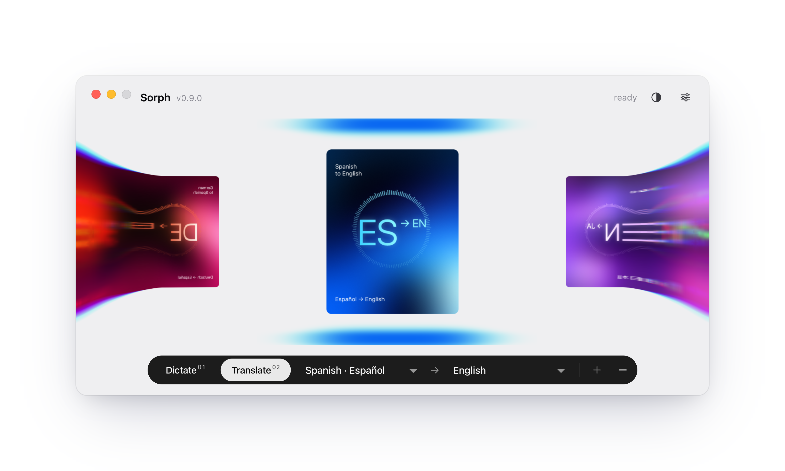
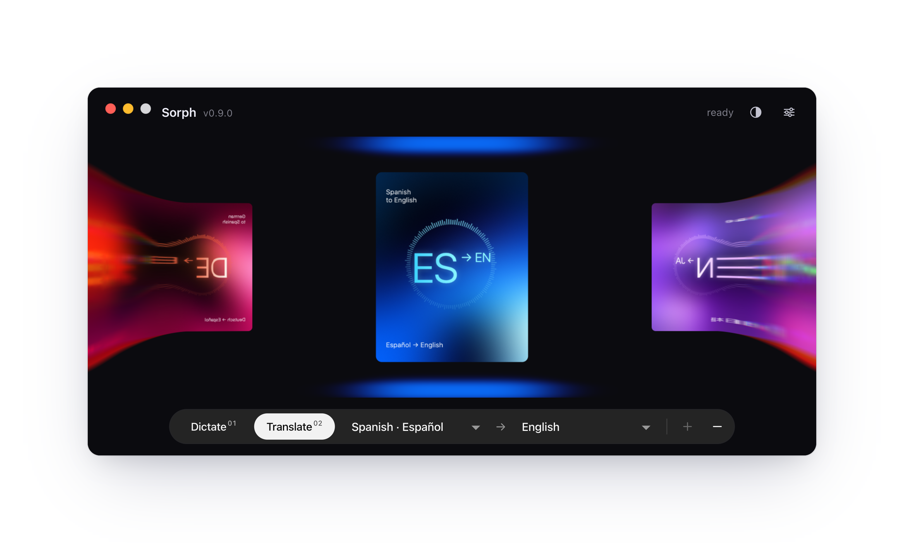

# v0.9.0 — Sorph light

Thank you for using Sorph. This release adds translation and a window
of its own, and still makes Sorph a smaller download than before: 0.8 GB
for dictation in every language.



## The light build

- **0.8 GB for all 99 languages.** The installer downloads what
  dictation needs and nothing else: the speech models (0.6 GB), a 13 MB
  runtime and the Python packages. In v0.7.0 the same took 1.4 GB, and
  part of it arrived mid-use, the first time you switched language. Now
  a language switch never downloads anything.
- **Speech models at half the size.** Sorph always ran its Whisper
  models at 8-bit precision but downloaded them at 16-bit. They are now
  published as 8-bit files. On 60 recordings each of English, German,
  French and Japanese they transcribe as accurately as before.
- **The translation model arrives when you want it.** Gemma 3 (2.5 GB)
  is downloaded the first time you turn translate mode on, with the
  progress shown in the menu bar and in Sorph's window. If you never
  translate, you never download it. `./install.sh --translate` fetches
  it during the install instead, for a Mac that will be offline.
- **One model for translating and cleaning up.** The optional cleanup
  pass (`--with-cleanup`) now runs on the same Gemma 3, so there is one
  copy of the model instead of two, and no Ollama or Homebrew to
  install.
- **Still offline.** Once a model is on your Mac, Sorph reads it from
  disk. Nothing you say leaves your computer.

| | v0.7.0 | v0.9.0 |
|---|---|---|
| Dictation, English only | 0.8 GB | 0.8 GB |
| Dictation, all 99 languages | 1.4 GB, part of it on first switch | 0.8 GB, all at install |
| Translate mode | not available | 2.5 GB, once, on first use |
| Cleanup pass | 3.3 GB through Ollama and Homebrew | shares the translation model |

## Translate mode

- **Speak one language, write another.** Menu bar → **Translate** →
  pick the language to write; **Language** stays the one you speak.
  Your words are typed as you speak, in your language, and replaced by
  the translation when you finish.
- **Any language to any language.** All 99 spoken languages translate
  into each other, plus 16 more that can only be written. Small
  languages come out rougher than large ones.
- **Sorph runs the model itself.** Gemma 3 on a small llama.cpp runtime:
  nothing to start, and its memory is given back when you turn
  translate mode off. Needs macOS 13.3 or later; on an older macOS, or
  with `./install.sh --no-translate`, a smaller model (490 MB) does the
  job more roughly.

## A window of its own



- **A dashboard.** Sorph now opens a small window: the orb revealed out
  of glass while the models load, then a gallery of cards, each a pair
  of languages to speak and to write. Turn to a card and Sorph switches
  to it; save your own pairs as cards.
- **Settings behind one button.** Microphone, music ducking, the
  dictionary and the rest, in one place.
- **Light and dark**, following macOS or set with the ◐ button. Menu
  bar → **Open Sorph**, or a click on Sorph in the Dock, brings the
  window back.

## Also new since v0.7.0

These were prepared as v0.8.0, which was never published on its own.

- **No more invented text.** A TV, music or a voice in the next room
  could make Sorph write sentences nobody dictated. Sorph now learns
  how loud your voice is on each microphone and drops what is not you.
- **A personal dictionary.** Add a word Sorph should know (`Ollama`),
  or a fix for one it mishears (`terror form = Terraform`).
- **Correct yourself out loud.** Say "Tuesday, actually no, Wednesday"
  and Sorph writes "Wednesday". "Scratch that" works too. English only
  for now.
- **Per-app tone.** A one-line dictation gets no final period in chat
  apps, terminals and code editors.
- **No more typing into Finder.** Live typing only goes into a real
  text field; anywhere else the words show in the card.
- **One-command updates.** See Upgrading below.
- **Ready for Muxpane** (coming soon): answer an agent by voice, in
  translate mode too.

## Fixes

- With the cleanup pass on, Sorph could freeze after you released
  Right-Option.
- On a new install, `flow.py --transcribe` failed with the newest
  version of an audio library. The installer now stays on one that
  works.

## Upgrading

One command, from anywhere, for any earlier version:

```bash
curl -fsSL https://raw.githubusercontent.com/TrenchStrAvy/Sorph/main/update.sh | zsh
```

It finds your Sorph, pulls v0.9.0 and reinstalls it in place. Your
permissions, settings and dictionary are kept, and you do not grant
anything again.

- **Your speech models are kept.** Sorph goes on using the ones you
  have. The update only fetches the ones you are missing, at their new
  size (0.3 GB at most).
- **If you used the cleanup pass with Ollama**, the update moves it to
  Sorph's own Gemma 3, a one-time 2.5 GB download. Afterwards
  `ollama rm gemma3:4b` frees 3.3 GB, if nothing else of yours uses it.
- **Translate mode** asks for its 2.5 GB model the first time you turn
  it on.

## New install

```bash
git clone https://github.com/TrenchStrAvy/Sorph.git
cd Sorph && ./install.sh
```

Requires macOS and Python 3.10 or later. Full instructions are in the
[README](https://github.com/TrenchStrAvy/Sorph#readme).
